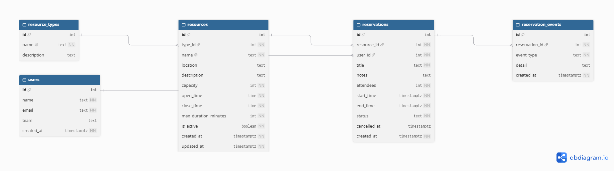

# ResourceHub — Resource Reservation Management System

A full-stack web application that lets an organisation manage its shared resources (meeting rooms, vehicles, equipment, labs…) and coordinate reservations **without double-bookings**.

Built for the PrimeWave Lab (Pvt) Ltd Software Engineering Internship technical assessment.

**Stack:** Next.js 15 (App Router) · TypeScript · PostgreSQL 16 · Zod · node-postgres · Git/GitHub

---

## 1. The problem I interpreted

The organisation books shared resources through chat messages and manual records. That causes overlapping reservations and nobody knows what is free. They need one central system that:

1. keeps a **catalogue of resources**,
2. lets people **reserve** them and **never overlap**,
3. shows **availability** and **usage** clearly,
4. stays **reliable as activity grows** (many people booking at the same time).

The last point drove the main engineering decision below.

## 2. Key engineering decision — the database prevents double-booking

A common approach is: *"check if the slot is free, then insert."* That has a **race condition**: two people can both pass the check at the same instant and both insert.

Instead, the rule is enforced **inside PostgreSQL**:

```sql
CONSTRAINT reservations_no_overlap EXCLUDE USING gist (
    resource_id WITH =,
    tstzrange(start_time, end_time, '[)') WITH &&
) WHERE (status = 'confirmed')
```

* Two confirmed reservations of the same resource can never overlap — guaranteed, even under concurrent requests or application bugs.
* `[)` ranges mean back-to-back bookings (10:00–11:00 then 11:00–12:00) are allowed.
* Cancelled reservations are excluded, so a cancelled slot is instantly free again.
* The API catches the DB error (`23P01`) and returns a friendly **409** with the clashing booking and the **next free slot that fits**.

`npm run test:concurrency` fires 30 simultaneous requests for the same slot: exactly one succeeds, 29 receive 409.

## 3. Features

| Area | What it does |
|---|---|
| Resources | Create / edit / disable resources with type, location, capacity, opening hours and max booking length |
| Reservations | Book with title, attendees, notes; cancel (soft-cancel, history kept) |
| Overlap protection | Database-level guarantee + clear conflict message |
| Smart suggestions | On conflict, suggests the next free slot of the same length (skips closed hours, rolls to next day) |
| Availability | Per-day visual timeline, list of free gaps, click a free gap to pre-fill the booking form |
| Business rules | Opening hours, max duration, capacity, no bookings in the past, disabled resources can't be booked |
| Dashboard | Today's schedule, upcoming bookings, "in use now", 30-day utilisation per resource |
| Filtering | Reservations by resource, status, upcoming/past, free-text search |
| Audit trail | `reservation_events` records created / cancelled events |
| Validation | Zod on every API input; consistent JSON errors |

## 4. Getting started

**Prerequisites:** Node.js 20+ and Docker (or any PostgreSQL 14+).

```bash
# 1. Clone and install
git clone <your-repo-url>
cd primewave-resource-reservation
npm install

# 2. Configure environment
cp .env.example .env

# 3. Start PostgreSQL (Docker)
docker compose up -d

# 4. Create tables + load demo data
npm run db:setup

# 5. Run the app
npm run dev
```

Open <http://localhost:3000>.

Using your own PostgreSQL instead of Docker? Create a database and set `DATABASE_URL` in `.env`. The migration needs permission to run `CREATE EXTENSION btree_gist` (included in standard PostgreSQL contrib).

### Scripts

| Command | Purpose |
|---|---|
| `npm run dev` | Development server |
| `npm run build && npm start` | Production build |
| `npm run db:migrate` | Apply SQL migrations in `db/migrations` (tracked, runs each once) |
| `npm run db:seed` | Insert demo data (skipped if data exists) |
| `npm run db:setup` | migrate + seed |
| `npm test` | Unit tests for scheduling logic (Vitest) |
| `npm run typecheck` | TypeScript check |
| `npm run test:concurrency` | Race-condition proof (app must be running) |

## 5. Project structure

```
db/migrations/001_init.sql      Schema, constraints, indexes
scripts/                        migrate, seed, concurrency test (plain Node)
src/lib/
  db.ts                         Pooled PostgreSQL connection
  slots.ts                      PURE scheduling logic (overlap, opening hours, next free slot)
  time.ts                       Time-zone helpers (org zone vs UTC)
  validation.ts                 Zod schemas
  services/                     All SQL + business rules (resources, reservations)
src/app/api/                    REST route handlers (thin: validate → service → JSON)
src/app/                        Server-rendered pages (dashboard, resources, reservations)
src/components/                 Client components (forms, cancel, timeline)
docs/                           ER diagram sources
```

Layering: **route handler → service → SQL**. Pages read through the same services, so rules live in one place. `slots.ts` has no I/O, which makes it easy to unit-test.

## 6. REST API

| Method | Endpoint | Description |
|---|---|---|
| GET | `/api/resources?includeInactive=true` | List resources |
| POST | `/api/resources` | Create resource |
| GET / PUT / PATCH | `/api/resources/:id` | Read / update / enable-disable (`{isActive}`) |
| GET | `/api/resources/:id/availability?date=YYYY-MM-DD` | Day timeline, free slots, utilisation |
| GET | `/api/reservations?resourceId=&status=&when=&search=` | List with filters |
| POST | `/api/reservations` | Create (201, or 400 rule violation, or 409 overlap + suggestion) |
| GET / DELETE | `/api/reservations/:id` | Read / cancel |
| GET | `/api/stats` | Dashboard numbers and 30-day utilisation |

Example conflict response:

```json
{
  "error": "\"Boardroom Alpha\" is already reserved for part of that time",
  "details": {
    "conflictingReservation": { "title": "Sprint planning", "start": "...", "end": "..." },
    "suggestedSlot": { "start": "...", "end": "..." }
  }
}
```

## 7. Design decisions & trade-offs

* **Raw SQL with `pg` instead of an ORM.** The exclusion constraint and range operators are PostgreSQL-specific; plain SQL keeps them visible and avoids ORM limitations. Services keep SQL out of the UI.
* **Time zone.** Instants are stored as `TIMESTAMPTZ` (UTC). Opening hours are wall-clock times in the organisation's zone (Sri Lanka, UTC+05:30, no DST) configured via `APP_UTC_OFFSET_MINUTES`. A fixed offset avoids a date library; a DST-observing region would need a proper tz library.
* **Soft cancel.** Cancelling sets `status='cancelled'` rather than deleting, so usage statistics and audit history stay correct.
* **Soft-disable resources** (`is_active`) instead of deleting, for the same reason; foreign keys use `ON DELETE RESTRICT`.
* **Pool-safe error handling.** The connection is released *before* building the friendly conflict message. (Found by the concurrency test: holding a connection while requesting another deadlocks the pool under load.)
* **Server components for reads**, client components only where interaction is needed (forms, cancel button) — less JavaScript shipped.
* **Users identified by e-mail** (case-insensitive unique index, upsert on booking).

## 8. Assumptions & scope

* No authentication: anyone can book or cancel. In a real deployment, login + roles (users cancel only their own bookings, admins manage resources) would be the first addition. I left it out to focus on the core scheduling problem, as the brief asks for a focused exercise.
* Reservations are single-day and within opening hours (no overnight or multi-day bookings).
* No recurring reservations, e-mail notifications or approval workflow.

## 9. Possible next steps

Authentication and roles · recurring bookings · e-mail/calendar (.ics) notifications · maintenance blackout periods · per-team quotas · integration tests against a test database.


## 10. Entity Relationship Diagram

See [`docs/ER-diagram.md`](docs/ER-diagram.md) (Mermaid, renders on GitHub) and [`docs/schema.dbml`](docs/schema.dbml) (import into dbdiagram.io).

Live diagram: [View on dbdiagram.io]
(https://dbdiagram.io/d/6acf385e064322c869465d53)

