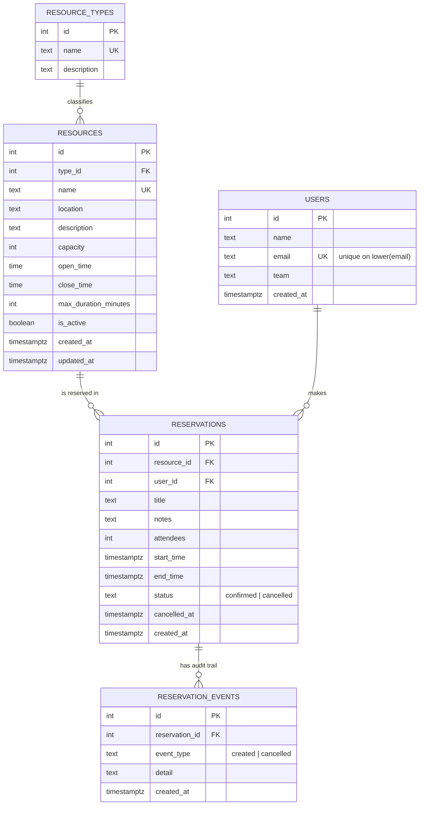

# Entity Relationship Diagram

GitHub renders the Mermaid diagram below automatically.

## Key constraint (not visible in the diagram)

`reservations` has an **EXCLUDE USING gist** constraint on `(resource_id =, tstzrange(start_time, end_time, '[)') &&) WHERE status = 'confirmed'`.
It makes overlapping confirmed reservations for the same resource impossible at database level.
